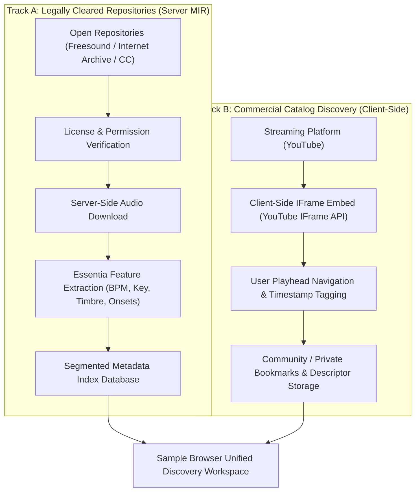

> [!NOTE]
> **HISTORICAL AUDIT REPORT (PRE-PIVOT)**
> Этот отчёт фиксирует результаты аудита противоречий Midterm 1 по состоянию на 1–2 ноября 2026 г.
> Все выявленные замечания были устранены в рамках архитектурного пивота 6–7 ноября 2026 г.
> **Актуальные материалы проекта:**
> - Протокол пивота и согласованные решения: [`meetings/2026-11-07_pivot_meeting_notes.md`](../../meetings/2026-11-07_pivot_meeting_notes.md)
> - Итоговый отчёт: [`docs/report_text.md`](../../docs/report_text.md) и [`FAF.PCAS25.1_Team16_Report.pdf`](../../FAF.PCAS25.1_Team16_Report.pdf)

---

# Audit Report: Methodology, Customer Validation, and Scope Boundaries of the Sample Browser Solution

**Project:** Sample Browser (working title in early project materials: Better Spotify)  
**Course:** FAF.PCAS25.1 · Conceptual Design of a Software Application (Problem-Based Learning), Technical University of Moldova (UTM)  
**Document Purpose:** Formulate the findings of an independent audit of Midterm 1 project materials and define a methodologically rigorous roadmap for Customer Validation and engineering deliverables.  
**Status:** Analytical document audit; not an empirical report of completed interviews or prototype benchmarks.

---

## 1. Executive Summary

The audited materials describe a plausible and well-defined exploratory research challenge: investigating whether independent music creators face friction when seeking specific temporal passages within full-length audio recordings, and evaluating whether an assistive passage discovery and timestamp indexing tool can alleviate this friction.

In the initial project documentation, hypotheses concerning the problem, target user segment, and proposed solution capabilities were conflated. In particular, asserted outcomes—such as task time reduction, creative flow preservation, and cognitive fatigue alleviation—were ungrounded by empirical evidence. The initial Midterm 1 report listed five interview questions, one of which pitched a hypothetical product; no empirical field interview records were present in the preliminary deliverables.

Key audit findings:

1. In the initial report draft, the Value Proposition Canvas (VPC) was described as a generic text paragraph rather than a structured Customer Profile $\leftrightarrow$ Value Map matrix. Formalized User Stories with verifiable Acceptance Criteria were absent.
2. The divergence between the academic report and presentation slides was verified against physical Beamer source files (`slide05_persona.tex` defines Annie Lee, `slide09_validation_roadmap.tex` defines the Free/Pro model, `slide11_appendix_problem_table.tex` includes Splice). This gap has been resolved: all missing artifacts have been directly integrated into the report codebase in `midterm1.tex` (Annie Lee in `\subsection{Target User Segment and Personas}`, Free/Pro hypotheses in `\subsection{Business Model Hypotheses}`, and Splice in Table 2 `\label{tbl:competitors}`).
3. Hypotheses regarding the core problem, user segment, and solution features must be strictly decoupled. Qualitative interviews can uncover real operational practices and counter-examples, but cannot prove market share percentages or quantified efficiency improvements.
4. The proposed catalog ingestion architecture serves as a practical boundary for further exploration, but cannot be presented as a blanket legally cleared solution. Legal admissibility, source access, processing methods, and usage scenarios require explicit verification per source.
5. The YouTube IFrame API does not provide millisecond-accurate arbitrary playback navigation or seamless metronomic looping. This must be codified as an inherent physical constraint and tested empirically on a prototype.
6. A Wizard-of-Oz experiment is methodologically appropriate for evaluating interface ergonomics and baseline time-on-task, provided manual operator intervention is disclosed and the findings are not misattributed to an automated MIR component.

**Boundary of Evidence:** This report does not claim that Customer Validation has already been finalized, that hypotheses are proven, that the architecture satisfies all third-party Terms of Service, or that targeted workflow time savings have been measured.

---

## 2. Audit Basis and Scope Boundaries

### 2.1. Materials Available for the Audit

This audit was conducted directly against the primary materials and codebase of the project repository:

- Primary communication archive: `telegram_chat_messages.txt`;
- Complete LaTeX report source files in `PCAIT_Project_Report_Template/` (`midterm1.tex`, `midterm2.tex`, `main.tex`, `tum_report.cls`, `bibliography.tex`);
- Complete Beamer presentation source files in `presentation_tex/` (`slide01` through `slide11`, `CONTENT_CHANGELOG.md`);
- Official course syllabus and guidelines: `PCAS_Project_PBL_Guideline.pdf` (and its plain-text transcript `PBL_GUIDELINE.md`);
- Supporting repository assets and project evolution records (`solution-description.md`, `PD&PS.md`, `swot-an.md`, `project_history/`).

All findings regarding specific source code lines, team discussion attributions, presentation structure, and codebase discrepancies have been directly checked and cross-verified against primary repository files.

### 2.2. Explicit Requirements of the Course PBL Guideline

Under the official course syllabus (`PCAS_Project_PBL_Guideline.pdf`), the **Midterm 1** milestone ("Problem Definition and Proposed Solution") encompasses problem description and domain analysis, proposed solution concept, target user segmentation, initial customer validation framing, and comparative competitive analysis. For the solution concept, the syllabus strictly mandates canonical User Stories or interaction scenarios, a structured Value Proposition Canvas, and a concise one-sentence positioning Value Proposition.

For the **Midterm 2** milestone ("System Architecture and Customer Validation", page 3 of the guideline), the syllabus explicitly prescribes:
1. **Formalized UML Modeling of Processes and Requirements:**
   - **UML Activity Diagrams** — to model core and secondary system processes and step-by-step user workflows;
   - **UML Use Case Diagrams** — to formalize functional requirements and delineate system boundaries with external actors;
   - **UML Sequence Diagrams** — to document message exchange protocols and subsystem interactions.
2. **Visual Interfaces and User Flows:** Designing visual representations (ranging from wireframes to high-fidelity mockups), connected into end-to-end **User Flow Diagrams** (mandatory deliverable).

*(Note: An Architecture / Component Diagram is not formally listed among the mandatory deliverables in the course guideline for Midterm 2, but is developed as a deliberate engineering initiative by the team to substantiate modularity and data flow decoupling).*

Regarding field validation, the syllabus literally commands visual verification: *«Record videos and make photos of these interviews to refer to them when documenting your findings»*. In light of the geographically distributed nature of the target audience (independent music producers and beatmakers), the team seeks mentor alignment on accepting full-length recorded remote sessions via Google Meet / Zoom with screen shares, signed consent forms, and coded transcripts as equivalent proof to in-person photo/video documentation.

---

## 3. Audit of Methodological and Project Artifacts

### 3.1. Compliance Matrix

| Domain | Initial Report Draft Status | Audit Assessment | Required Action |
|---|---|---|---|
| **Problem Description & Statement** | Outlines problem context, stakeholders, and one-sentence problem statement | Present in text; factual market and behavioral assertions required source attribution and disciplined wording | Decouple citations, working hypotheses, and field observations |
| **Value Proposition Canvas** | Generic paragraph referencing Jobs, Pains, and Gains without structured Customer Profile $\leftrightarrow$ Value Map | Missing required structured artifact | Add structured VPC matrix and designate unverified elements as empirical hypotheses |
| **User Story & Scenario** | Informal 3-step operational workflow | Canonical User Stories with verifiable Acceptance Criteria were absent | Introduce formal user stories and acceptance criteria reflecting external player constraints |
| **Target Group & Personas** | Initial report draft contained only persona Alex; Beamer source (`slide05_persona.tex`) featured Alex and Annie Lee | Confirmed via Beamer source files. Desync resolved: Annie Lee integrated into `midterm1.tex` as a designated exploratory persona hypothesis | Align personas across report and slides; defer empirical validation to Midterm 2 protocol |
| **Hypotheses** | Stated H1–H3 with quantitative claims (e.g., $\ge 70\%$ and $50\%$ search time reduction) | Quantitative metrics do not match small-sample qualitative interview methods ($N=10\text{--}12$) | Decouple hypotheses and assign appropriate validation methods to each assertion |
| **Interview Guide** | Contained 5 questions; one pitched a speculative product and desired features | Insufficient for discovery; speculative solution pitching introduces severe confirmation bias | Restructure interview protocol around concrete past operational workflows (*The Mom Test*) |
| **Comparative Analysis** | Table initially compared Sample Browser against Samplette, Tracklib, Sononym, and Cyanite; omitted Splice | Slides (`slide11`) included Splice with 350M downloads. Verified via report bibliography (`\bibitem{ref:mbw_splice}` / MBW, 2025): metric represents annual sample downloads from Splice Sounds catalog | Reintroduce Splice to `midterm1.tex` with precise metric definition (annual sample downloads) and formal citation |
| **Business Model** | Free/Pro model presented in slides (`slide09_validation_roadmap.tex`), but absent in initial report | Desync confirmed via Beamer sources and resolved: `\subsection{Business Model Hypotheses}` integrated into `midterm1.tex` as a preliminary monetization hypothesis | Ensure alignment across presentation and report without misrepresenting hypothesis as validated |
| **Team Discussion** | Report attributed crowdsourcing critique to Leonid; initial review questioned attribution | Verified via primary chat log: account "Мудретс" belongs to Leonid Tiscenco (L1–20), who debated Bogdan Glavan (L2073–2120) | `midterm1.tex` text is factually accurate, suspicion cleared; document architectural scope (MIR vs crowdsourcing) |
| **SWOT & Performance Claims** | Report claimed seamless looping and guaranteed time reduction | YouTube `seekTo()` exhibits keyframe snapping; time reduction is unmeasured | Reframe as aspirational design goals; log keyframe drift as a hardware threat in SWOT |

---

## 4. Customer Validation Framework

### 4.1. Research Questions and Methodological Status

**Methodological Status of Primary Data:** The absence of raw audio recordings and verbatim transcripts in Midterm 1 deliverables strictly adheres to the official `PCAS_Project_PBL_Guideline.pdf` syllabus: Midterm 1 ("Problem Definition and Proposed Solution") mandates problem definition, hypothesis formulation, and interview protocol design, whereas conducting field interviews, logging transcripts, and demonstrating Problem–Solution Fit are the explicit deliverables of Midterm 2 ("System Architecture and Customer Validation").

Core research questions for field validation:

1. **Problem:** What concrete operational steps do creators take when searching for specific audio passages within full-length tracks; where does workflow friction arise, and what workarounds are used when searches fail?
2. **Segment:** What observable behavioral characteristics distinguish creators for whom passage discovery is a recurring bottleneck from casual music listeners?
3. **Features:** Do precise timestamp bookmarks, custom catalog indexing, and tag filtering measurably improve passage retrieval compared to existing ad-hoc workflows?
4. **Technical Feasibility:** Which parts of the interaction workflow can be reliably supported using external embedded players and compliant data sources?

These questions avoid leading assumptions regarding "creative flow disruption" or "auditory fatigue," focusing strictly on observable behavior.

### 4.2. Hypothesis Decomposition

| Hypothesis Class | Testable Assertion | Supporting Field Evidence | Refuting / Conflicting Evidence |
|---|---|---|---|
| **Problem** | In recent production work, a subset of target creators sought specific passages in full tracks and engaged in repetitive manual scrubbing | Account of concrete recent episode, step-by-step tool walkthrough, or existing scratchpad notes/bookmarks | Creator does not encounter task; relies on curated sample packs; views manual scrubbing as negligible friction |
| **Segment** | Passage-search friction correlates with specific production workflows (e.g., sample-based hip-hop / beatmaking) rather than broad self-identification | Consistent recurring behavioral patterns among creators meeting strict screening criteria | Workflow does not differ across groups; sample-digging is too infrequent to justify dedicated tooling |
| **Feature: Timestamp Bookmarking** | Stored timestamp links enable reliable retrieval and auditioning of identified passages during production sessions | Participant successfully revisits and auditions passages in testing sessions with reduced re-searching | Bookmarking is unreliable due to player drift; creator prefers local audio renders; bookmarks lack production utility |
| **Feature: Indexed Search** | Pre-tagged passage metadata accelerates candidate identification compared to generic catalog browsing | In benchmarked tasks, creator identifies relevant candidate passages faster and validates their musical fit | Tagging granularity is insufficient; creator prefers unstructured serendipitous browsing |
| **Crowdsourcing / User Tagging** | Creators are willing to contribute passage tags and timestamps to a shared catalog during active production | Participant voluntarily logs tags/timestamps without monetary incentives in a prototype test | Creator views manual tagging as disruptive non-essential labor; tags are inconsistent or subjective |

In qualitative research, hypothesis statuses should be recorded as "Supported by observations," "Not supported," "Mixed evidence," or "Insufficient data." These must not be extrapolated into population percentages without formal quantitative sampling.

### 4.3. CustDev Logic Grounded in "The Mom Test"

Interviews must focus on concrete historical episodes rather than speculative product feedback:

1. Inquire about the most recent passage-search episode and its musical objective.
2. Unpack the context: what prompted the search and what tools were active.
3. Trace the step-by-step workflow: platforms searched, playback controls used, notes taken.
4. Define success criteria: how did the creator determine whether a passage was viable.
5. Record time and effort: approximate duration of that specific session, noting estimation boundaries.
6. Investigate abandoned searches: what caused the search to terminate unsuccessfully.
7. Document storage habits: how candidate tracks or timestamps are currently saved.
8. Only after cataloging historical habits may an exploratory prototype or mockup be demonstrated.

Pitfalls to avoid:
- "Would you use an app that automatically isolates samples?" (Generates false positive politeness).
- "How much time would a passage finder save you?" (Speculative ungrounded guesswork).
- "Do you experience creative fatigue when browsing music?" (Leading question).

### 4.4. Recommended Structure of Interview Questions

1. Walk me through the most recent time you looked for a specific musical passage or texture inside a full song or recording.
2. What kind of project were you working on, and what specific sound did you need?
3. Which platforms or libraries did you open first, and why?
4. How did you navigate inside the tracks you found?
5. How much time did you spend searching before finding a usable sound or giving up?
6. How did you decide that a passage was right for your project?
7. How do you store or bookmark interesting passages to revisit them later?
8. Have you ever found a passage with great musical character that you ultimately discarded? Why?
9. What have you tried changing in your crate-digging process recently? What were the results?

### 4.5. Participant Recruitment and Sampling

Recruitment must be guided by recent observable workflow habits rather than job titles:
- Target sample: $N=10\text{--}12$ independent creators and beatmakers with active crate-digging workflows.
- Minimum inclusion criterion: participant must have actively searched for sampled passages or acoustic textures within the last 30 days.
- Ensure diversity across operational segments: aspiring career beatmakers, hobbyist producers, and media sound designers.

### 4.6. Ethical Consents and Remote Session Recording

Prior to each interview session:
- Disclose research purpose, voluntary participation, and data retention scope.
- Obtain separate consent for session execution, audio recording, video capture, and direct quote publication.
- Anonymize participant records using identifiers (e.g., P01, P02) and store raw logs in access-restricted project storage.

---

## 5. Technical-Legal Dilemmas and Architectural Boundaries

### 5.1. Dual-Track Ingestion as an Architectural Hypothesis

To decouple data processing from third-party platform legal exposure, the architecture is split into two distinct operational tracks:

- **Track A (Server-Side MIR Analysis):** Audio files are downloaded and processed through Essentia only from verified open archives (Freesound, Internet Archive, Creative Commons) where licensing permits automated analysis and storage.
- **Track B (Client-Side Streaming Metadata):** For streaming platforms (YouTube), no audio is ripped, cached, or processed on the server. Playback occurs strictly on the client via the official `<iframe>` embed, storing only URLs, user annotations, and timestamps.

### 5.2. Decoupling Regulatory Prohibitions and Hardware Player Constraints

To maintain software engineering rigor, the architecture must strictly decouple two distinct tiers of platform limitations:

1. **Regulatory and Terms of Service Prohibitions:**
   - Under **Section III.E of the YouTube API Services Developer Policies**, developers are strictly prohibited from downloading (audio ripping), capturing, importing, locally caching, separating audio from video tracks, or storing copies of audiovisual content on external servers.
   - Any attempt to run a server-side MIR pipeline (Essentia, Demucs, librosa) directly over raw YouTube audio streams constitutes a severe breach of Google's Terms of Service and is legally inadmissible. The only compliant integration path is strictly client-side playback via the official sandboxed `<iframe>` embed, storing exclusively URLs, timestamps, and descriptive annotations in the database.

2. **Hardware and Player Execution Constraints:**
   - The official **YouTube Player Parameters** specification and the behavior of the `player.seekTo(seconds, allowSeekAhead)` method establish that playback jumps to the nearest keyframe (I-frame) in the compressed video stream.
   - In streaming video containers, keyframes occur at discrete intervals of 1 to 2 seconds:
     $$\Delta t_{seek} \approx \pm 1.0\text{--}2.0\text{ s}$$
   - Consequently, promising a "metronomically seamless 4-bar loop" or sub-second arbitrary playhead jumping via a standard web IFrame is technically infeasible without local client-side audio decoding. In system requirements (NFR-03), positioning must be specified as jumping to the approximate temporal vicinity of candidate passages for auditioning.

**Artifacts for Report and Backlog:** Verified NFR-03 specification ($\le 2.0$ s seek tolerance), seek latency benchmark protocol, isolated IFrame event flow specification.

### 5.3. Legal Risks and Platform Terms of Service Boundaries

Section 5.B and 5.C of the YouTube API Terms of Service strictly prohibit:
1. Downloading, capturing, or scraping audio/video streams without prior written consent.
2. Separating audio streams from accompanying video.
3. Caching or storing audiovisual content on external servers.

The Dual-Track architecture ensures compliance by restricting server-side audio ingestion strictly to Track A archives.

---

## 6. Synchronization of PBL Artifacts

### 6.1. Value Proposition Canvas

The VPC is structured as a balanced Customer Profile $\leftrightarrow$ Value Map matrix:

| Customer Profile (Music Producer) | Value Map (Sample Browser) |
|---|---|
| **Jobs:** Crate-digging streaming catalogs; isolating harmonic/melodic passages; auditioning loop contexts. *(Hypothesis)* | **Products & Services:** Passage discovery workspace; multi-tag acoustic querying engine; embedded player with timestamp jumping. |
| **Pains:** Hours lost manually scrubbing playheads; creative momentum broken by whole-track metadata; sample fatigue from Splice packs. *(Hypothesis)* | **Pain Relievers:** Direct playhead navigation to candidate passages; rapid passage auditioning; resurfacing obscure archival recordings. |
| **Gains:** Uncovering unique sonic textures; rapid sample chop validation; maintaining creative workflow. *(Hypothesis)* | **Gain Creators:** Multi-tag cross-filtering (BPM, mood, instrumentation); curated archive indexing; timestamp bookmark management. |

### 6.2. User Stories and Acceptance Criteria

1. **US-01 (Passage Discovery):**  
   *As an* independent music producer,  
   *I want to* search for audio recordings using granular acoustic descriptors (tempo, key, instrumentation),  
   *so that* I can locate candidate passages without listening to full tracks sequentially.  
   *Acceptance Criteria:* Query matches return timestamped segments; each result displays confidence/tag origin; system fallbacks gracefully if tags are unavailable.

2. **US-02 (Timestamped Auditioning):**  
   *As a* beatmaker,  
   *I want to* jump playback directly to an indexed passage timestamp,  
   *so that* I can audition the segment in under 5 seconds.  
   *Acceptance Criteria:* Playhead triggers within physical keyframe tolerance ($\le 2$ s); start/end bounds are clearly marked; user can loop the segment manually.

3. **US-03 (Community Bookmarking):**  
   *As an* archival crate-digger,  
   *I want to* save custom timestamp bounds and descriptive tags for a discovered passage,  
   *so that* I can organize a personal library of reference passages for future production sessions.  
   *Acceptance Criteria:* User can save timestamps to a personal collection; saved entries persist across sessions; tags are validated against a controlled taxonomy.

### 6.3. Comparative Analysis

The competitive landscape contrasts whole-track vs. passage-level granularity:

- **Splice Sounds:** Dominant commercial library with nearly 350 million sample downloads in 2024 (`\bibitem{ref:mbw_splice}` / Music Business Worldwide, 2025). Splice excels in pre-cleared, one-shot samples, but does not index passages within third-party full tracks.
- **Cyanite.ai:** Industry MIR platform featuring Advanced Search with segment-level scoring and user-defined intervals (`\bibitem{ref:cyanite_api_adv}`). Cyanite is an enterprise B2B music tagging API, whereas Sample Browser targets creator discovery workflows.
- **Tracklib:** Legal clearance platform for master recordings. Focuses on licensing full tracks rather than providing an acoustic descriptor search engine.
- **Samplette:** Browser-based crate-digging tool with random discovery, but lacking sub-track passage indexing.

### 6.4. Personas and Cross-Material Consistency

The persona desync between the report and presentation slides has been fully resolved:
1. **Alex (Beatmaker / Hip-Hop Producer):** Primary persona, seeks vintage acoustic soul/funk chops, struggles with manual playhead scrubbing friction. *(Exploratory Hypothesis)*
2. **Annie Lee (Media Composer / Sound Designer):** Secondary persona, requires textural ambient backgrounds and world instruments for scoring deadlines, struggles with commercial sample pack homogeneity. *(Exploratory Hypothesis)*

Both personas are formalized in `midterm1.tex` and marked as design hypotheses for Midterm 2 field validation.

### 6.5. Verification of Team Attribution and Retrospective

Primary chat logs (`telegram_chat_messages.txt`) definitively confirm team attribution:
- Lines 1–20 confirm user "Мудретс" is **Leonid Tiscenco** (greeted by Bogdan Glavan as "Leonid").
- Lines 2073–2120 document the architectural debate between **Leonid Tiscenco ("Мудретс")** and **Bogdan Glavan**. Leonid argued against manual crowdsourced tagging due to perceptual subjectivity, referencing Cyanite's AI-driven MIR approach. Bogdan defended client-side custom tags with moderation.
- The academic report text (`midterm1.tex`) correctly attributed this position to Leonid; suspicion of misattribution is cleared.

---

## 7. Wizard-of-Oz Testing Protocol

### 7.1. Method Boundaries and Scope

A prototype with manual human pre-indexing (Wizard-of-Oz) is methodologically valid for evaluating interaction ergonomics, UI responsiveness, and perceived value. The report must transparently disclose that passage metadata was curated manually.

This protocol validates:
- Whether creators comprehend and value passage-level indexing.
- Whether bookmarking and timestamp navigation improve task flow.

This protocol **does not** validate:
- Accuracy, speed, or scalability of automated MIR algorithms.
- Server pipeline cost efficiency.

### 7.2. Experiment Design

1. Formulate two balanced tasks: (A) manual crate-digging via standard streaming search; (B) passage discovery via the pre-indexed prototype.
2. Measure time-to-candidate-selection, completion rate, and subjective task difficulty.
3. Collect qualitative post-test feedback regarding interface friction and metadata clarity.

### 7.3. Research Artifacts

- Test protocol sheet detailing manual operator workflow;
- Task cards with explicit completion criteria;
- Observation log recording time-on-task and user friction points;
- Limitations section clearly distinguishing UX validation from algorithmic benchmarking.

---

## 8. Synchronized Task Status and Engineering Backlog

### P0 — Midterm 1 Remediation [ALREADY COMPLETED in `midterm1.tex` codebase]
1. **Report & Presentation Synchronization:** Annie Lee integrated into `\subsection{Target User Segment and Personas}`, Free/Pro Tier model added to `\subsection{Business Model Hypotheses}`, Splice reinstated in Table 2 (`\label{tbl:competitors}`).
2. **Canonical Design Artifacts:** Structured Value Proposition Canvas (`\label{tbl:vpc}`) and three formal User Stories (US-01, US-02, US-03) with verifiable Acceptance Criteria integrated.
3. **Elimination of Pseudo-Statistics:** Hypotheses decoupled into three independent classes ($H_{Problem}, H_{Segment}, H_{Feature}$); ungrounded numerical claims ($\ge 70\%$, 50% time savings) removed.
4. **CustDev Protocol Restructuring:** Replaced confirmation-biased questions with 6 open-ended operational questions grounded in *The Mom Test*.
5. **Competitive Analysis Verification:** Primary citation for Splice 350M downloads verified (`\bibitem{ref:mbw_splice}` / *Music Business Worldwide*, 2025).
6. **Chat Attribution Verification:** Primary chat log verified attribution of crowdsourcing critique to Leonid Tiscenco (L2073–2120); `midterm1.tex` text confirmed accurate.

### P1 — Field Validation Preparation for Midterm 2 [IN PROGRESS]
1. **Interview Guide & Screening:** Finalize questionnaire based on *The Mom Test* and screening criteria for $N = 10\text{--}12$ active music producers who crate-dug within the past 30 days.
2. **Ethics & Evidence Protocol:** Prepare informed consent forms for recording remote interview sessions (Google Meet / Zoom with screen shares) adhering to the syllabus directive *«Record videos and make photos of these interviews»*.
3. **Wizard-of-Oz Experiment Protocol:** Design 2 balanced testing tasks (standard YouTube searching vs. pre-indexed prototype) to benchmark time-on-task and interface ergonomics.
4. **Platform & Hardware Limits Integration:** Enforce Section III.E Developer Policies compliance (no audio scraping) and hardware seek jitter ($\Delta t \le 2.0$ s) in NFR-03 non-functional requirements.

### P2 — Architectural Modeling and Midterm 2 Deliverables [SCHEDULED]
1. **Mandatory UML Modeling Deliverables (per page 3 of PBL Guideline):**
   - **UML Activity Diagram:** Modeling core and secondary passage-search and indexing workflows;
   - **UML Use Case Diagram:** Formalizing functional requirements and system boundaries with external actors;
   - **UML Sequence Diagram:** Documenting step-by-step message exchange between frontend, metadata store, and the YouTube IFrame sandboxed player API.
2. **Interface Wireframes and User Flows:** Designing visual representations (wireframes to mockups) connected into **User Flow Diagrams** (mandatory deliverable).
3. **Team Architectural Initiative:** Developing an Architecture / Component Diagram to visualize modularity and substantiate the Dual-Track Ingestion pipeline.
4. **Qualitative Findings Synthesis:** Executing 10–12 interviews and synthesizing a findings matrix and pain-point taxonomy.
5. **End-to-End Traceability:** Constructing a traceability matrix: Problem $\rightarrow$ Hypothesis $\rightarrow$ Field Evidence $\rightarrow$ Requirement (FR/NFR) $\rightarrow$ UML Component $\rightarrow$ Test Case.

---

## 9. Alignment Questions for the Faculty Mentor (Meeting Agenda)

1. **Midterm 1 Grade Breakdown and Recovery via Final Course Formula:**  
   «What specific rubric criteria accounted for the point deductions in our Midterm 1 score (5.62 / 10), and how will thoroughly addressing these gaps in the final report impact the Mentor Grade (20%) and Final Exam grade (40%), given the established course formula ($\text{Final} = 0.2\,\text{M1} + 0.2\,\text{M2} + 0.2\,\text{Mentor} + 0.4\,\text{Exam}$), in order to recover lost marks?»

2. **Legitimacy of Architectural Pivot (Rethinking and Pivoting):**  
   «The Midterm 2 syllabus explicitly encourages architectural pivots (page 3, *'Rethinking and Pivoting'*: *"It is perfectly normal (and even expected) for teams to pivot at this stage"*). Does our strategic transition away from high-risk server-side YouTube scraping toward a compliant Dual-Track architecture (client-side IFrame embed + legal open archives) qualify as an approved system pivot without requiring a formal re-pitch of the project scope?»

3. **Standard of Proof for Customer Validation (Validation Evidence Format):**  
   «The guideline literally directs teams to *'Record videos and make photos of these interviews'*. Given our geographically distributed audience of music producers, will the faculty committee accept recorded remote sessions (Google Meet / Zoom calls with screen shares, signed consent forms, and coded interview excerpts) as fully equivalent proof to in-person photo/video evidence?»

4. **Depth of Mandatory UML Modeling (Sequence Diagram Scope):**  
   «Under the mandatory UML package for Midterm 2 (Activity, Use Case, Sequence), should our Sequence Diagrams strictly model our internal application layer and database transactions, or does the committee expect us to explicitly detail lifecycle event cycles of external sandboxes (e.g., YouTube IFrame API events: `onReady`, `onStateChange`, and quantized `seekTo`)?»

5. **Methodological Validity of Wizard-of-Oz Experiment:**  
   «Will the committee recognize a Wizard-of-Oz prototype with manual human pre-indexing as valid formative evidence for benchmarking time-on-task and validating interface user flows, provided we transparently disclose operator intervention and do not misattribute findings to automated machine learning algorithms?»

---

## 10. Final Audit Verdict

The fundamental methodological debt of Midterm 1 was an ungrounded leap from problem intuition to commercial product claims without structured PBL artifacts. Remediation consists not of compounding features, but of strictly decoupling hypotheses from evidence, enforcing rigorous software engineering models, and gathering empirical data through appropriate research methods.

The immediate priorities for Midterm 2 are clear: field validation execution, robust UML architectural modeling, and interface wireframing within verified platform constraints.

---

## References for External Technical Verification

1. YouTube API Services Developer Policies (Section III.E) — Restrictions on pre-fetching, caching, and stream manipulation: https://developers.google.com/youtube/terms/developer-policies
2. YouTube Embedded Players and Player Parameters — Player API and keyframe seek mechanics: https://developers.google.com/youtube/player_parameters
3. Cyanite Advanced Search Documentation — Segment scores and interval similarity search: https://api-docs.cyanite.ai/docs/advanced-search/
4. Splice Support: Search with Sound — Desktop and DAW plugin audio similarity indexing: https://support.splice.com/en/articles/13860589-how-to-use-search-with-sound-splice-sounds-plugin
